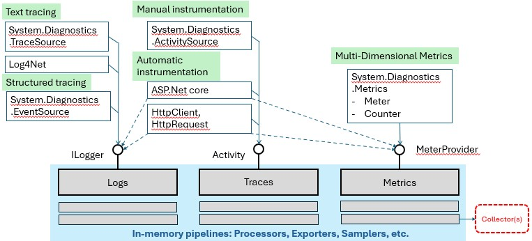
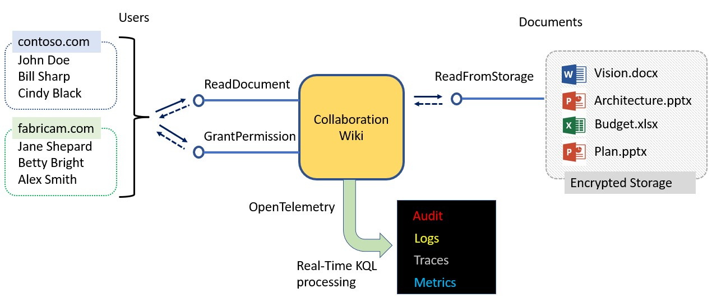

# Real-time KQL for service telemetry
This sample illustrates how to use Rx.KQL for Service telemetry. 

Using Rx.KQL allows

- the service to be instrumented once and forever, to produce all the data that will ever be of interest
- the telemetry system can choose which subset of data is of interest **at runtime**. 
This choice can be changed many times, without imact on the application and without code changes. 

## Context: OpenTelemetry
[OpenTelemetry](https://opentelemetry.io/docs/) is a new standard of decopling the applications from telemetry collectors. With OpenTelemetry, you can instrument your application once by following the language (e.g. C#) best practices. Then you can send the data to one or more collectors.

Here is how OpenTelemetry works in C#:

On the left, we see how the C# applications are instrumented to log text or structured objects. OpenTelemetry plugs into this existing pipeline - thus sending the data to a different collector does not require changes in the application.

On the right, we see a new API for Metrics, whhich replaces the OS concept of "Performance Counters".

Finally, applications which are using libraries like ASP.Net get most of the benefits without any effort, because the platform is already instrumented for OpenTelemetry.

For the purposes of example, the sample application is using exlicit instrumentation for Logs, Traces and Metrics. Because the processing hapens in the telemetry pipeline, the same method will work with automatic intrumentation.

## Sample application
The sample application is implementing an imaginary Wiki, in which:
- sometimes the users read documents
- sometimes a user edits a page or grants permission to another user (privileged operations)

As this is just a sample, there is no actual UI or HTTP requests involved. 
It is just a console application easy to read and debug (see [Program.cs](./Program.cs)):

        static RbackWiki _wiki; 

        static void Main(string[] args)
        {
            _wiki = new RbackWiki();
            while (true)
            {
                SimulateUsage(10);
                Thread.Sleep(1000);
            }
        }

Here _wiki is the imaginarry Wiki, created for collaboration between Constoso.com and Fabrikam.com.
It allows users from both companies to access common documents.

The method `SimulateUsage` will make 10 random requests. 
Because the Wiki is instrumented for OpenTelemetry, the data becomes available in four real-time streams:

- Audit for privileged operaions like user John Doe granting permission to Jane Shepard to edit Vision.docx
- Logs for who read given document
- Traces, with detailed timing like what time was sent in the Wiki vs. the Encryted Storage
- Metrics, about how many times each document was read

## Running the sample
To run the sample, let's first look at the [config.kql](./config.kql). 
This file has the default configuration, and will be copied to the output directory on rebuild of the project

To see all the real-time streams at once, 
make sure the file refers to each stream:

    audit

    logs

    traces 

    metrics

Run the sample console app. 
It shows all streams interleaved with different console colors.

To change the configuration at runtime, you can edit the copy in
`bin\Debug\net6.0\config.kql`. 

For example, to see only logs, you can change the file to:

    logs 
    | project Data.user, Data.document

Or

    logs
    | where Data.document == "Vision.docx"
    | project Data.user

To also see metrics in a friendly way you can add:

    metrics
    | project document=Tags.document, count=Value

It is important to note the difference:

- one copy of config.kql is part of the project codebase, and reresents the default data
- aother copy of config.kql can be changed **at runtime**